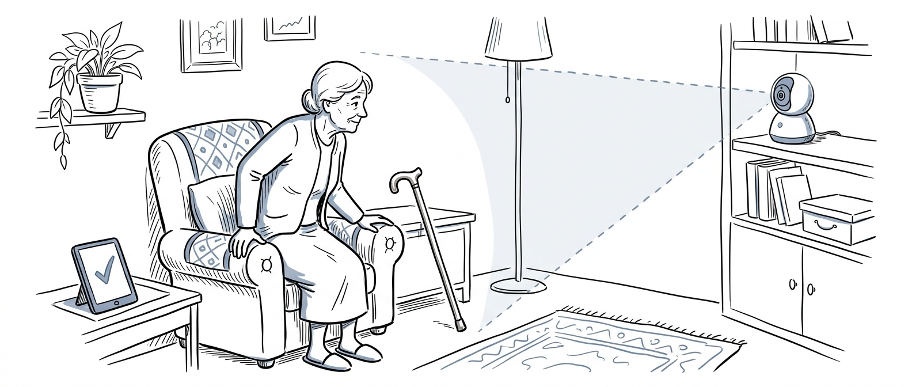
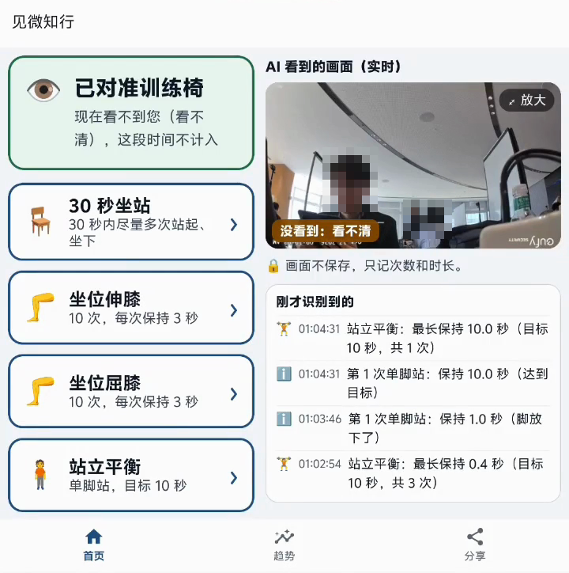
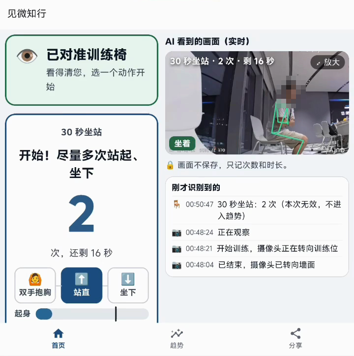
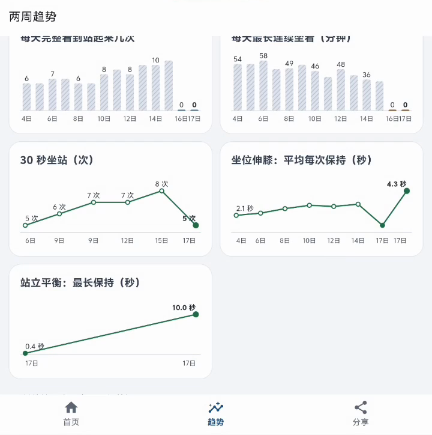
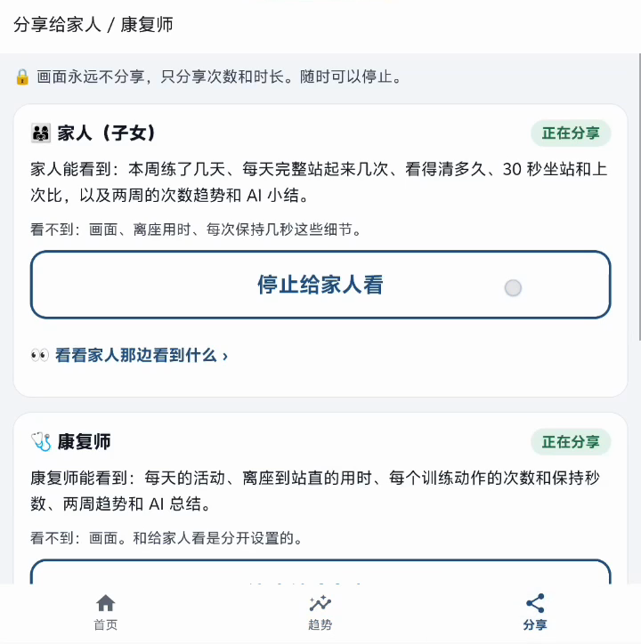
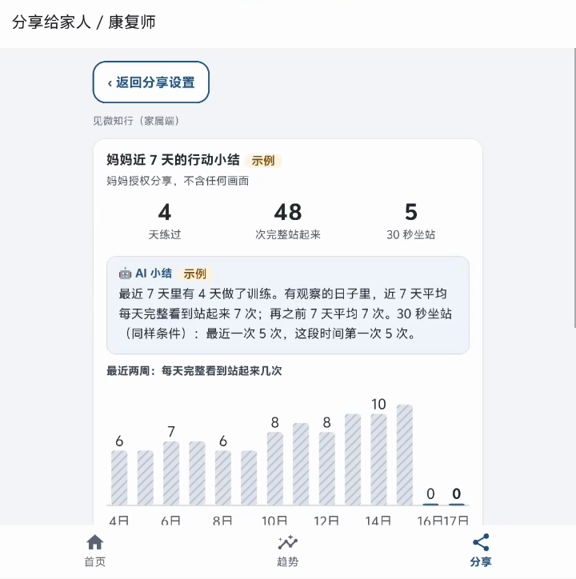
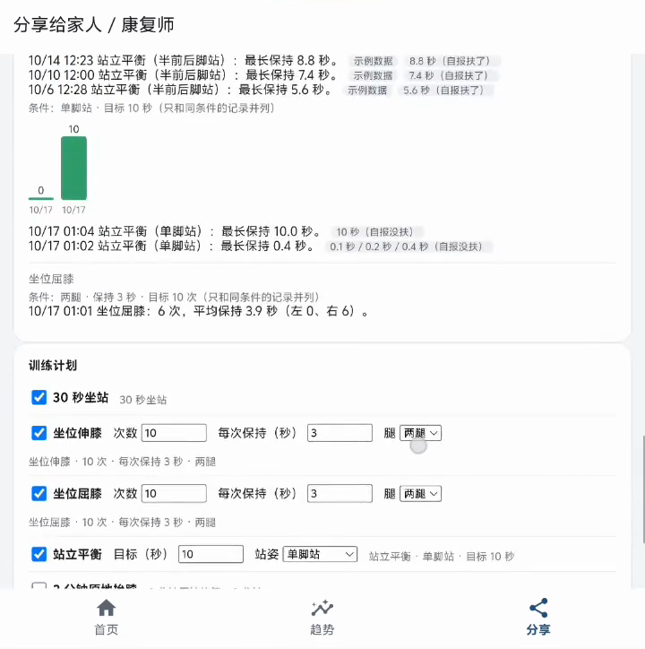
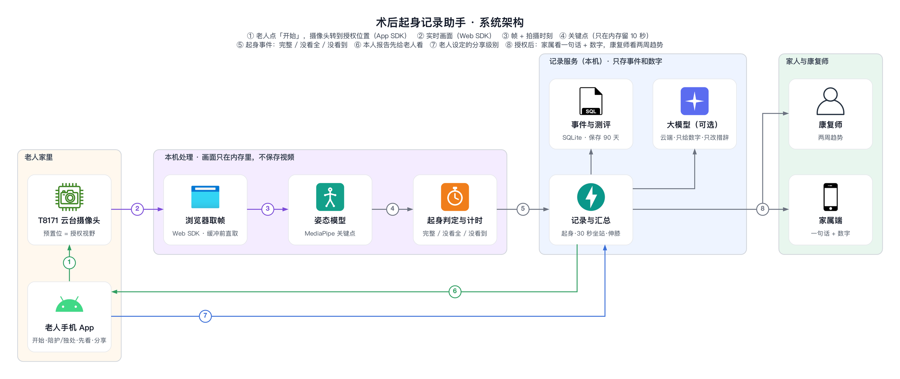

# 见微知行

**术后行动与训练观察 · 基于 eufy 云台摄像头的原型**

Anker 首届黑客松 · 智能安防赛道决赛作品（2026-10-16 至 10-17，现场 24 小时开发）



关节置换术后回到家，老人要自己练、自己起身；家人想知道恢复得怎样，又不该一直盯着监控。见微知行在老人主动开启后，把 eufy 摄像头转到授权的位置，用视觉 AI 把画面变成三类事实：**完整看到 / 没看全 / 没看到**。训练时给出次数、保持秒数和语音口令。结果先给老人本人看，本人分别授权后，家属和康复师才能看到摘要或明细。

AI 只提供看得到的事实和变化；能不能独处、要不要陪护，由本人、家人和专业人员商量决定。

## 截图

| 老人端：选动作，看 AI 实时识别 | 30 秒坐站：计次与口令 | 两周趋势 |
|:-:|:-:|:-:|
|  |  |  |
| **本人决定分享给谁** | **家属端：一句话 + 数字** | **康复师调整训练计划** |
|  |  |  |

截图来自折叠屏手机展开时的录屏。实时画面里的人脸已打码；标「示例」的是演示用的示例数据。

## 功能

- **日常观察**：摄像头转到日常区预置位，识别起身并分成三类。没看全的不计次数、不计时，并写明原因：断流、镜头在转、画面里没人、画面倒置、看不清。
- **康复训练**：30 秒坐站、坐位伸膝、坐位屈膝、站立平衡（另有原地抬膝、扶台面转移重心两个扩展动作），记录次数、保持秒数和实验性角度；手机念口令、报数、振动。
- **报告与授权**：报告先给本人。家属看「一句话 + 数字」，康复师看更细的记录和两周趋势；两边分别授权，随时可以撤销，每次读取都有记录。
- **训练计划**：康复师打开哪些动作，老人端就只显示哪些。
- **大模型摘要（可选）**：只把模板事实句改写得更口语；输出里的数字必须和统计一致，否则退回模板句。计次不依赖大模型。

## 架构



- **取帧**：Chrome 通过官方 Web SDK 收到 WebRTC 视频。SDK 给出的帧在抖动缓冲之后，10/16 实测比实际晚 3–6 秒；我们在缓冲之前截取 H.264 编码帧，用 WebCodecs 解码，再按 RTP 时间戳还原拍摄时刻（`web/src/utils/low-latency.ts`）。
- **识别**：MediaPipe Pose（日常用 full，训练用 heavy）→ One Euro 平滑 → 坐 / 站状态机 → 起身三分法、30 秒坐站和各训练动作（`server/jianwei/`）。
- **算不算数**：帧是否连续、镜头是否在转（先看云台指令状态，再用九宫格相位相关看画面位移）、画面里有没有人、是否倒置、关键点是否可信。任何一项不满足，就记「没看全」或「没看到」，不补数。
- **设备控制**：安卓 App 做设备桥，每 0.5 秒向分析服务拉一次指令，用官方 App SDK 转预置位、开关追踪、查询事件，回报确认和耗时；每 5 秒上报在线、电量、Wi-Fi 信号等状态（`JianweiBridge.kt`）。手机通过 USB `adb reverse` 连电脑。

## 隐私与数据

- 默认不保存原始视频：画面只在浏览器和分析服务的内存里逐帧处理，关键点只放在 10 秒的内存缓冲里。
- 数据库（SQLite）只存事件和数字，保留 90 天，可以删除。
- 家属和康复师的报告不附画面，需要本人分别授权，可以撤销。
- 暂停时摄像头转向朝墙的「隐私位」。这不等于物理关闭摄像头。
- 凭证不进仓库：`.env*`、`LocalSecrets.kt` 都在 `.gitignore` 里；摄像头 SN 由环境变量 `JW_CAMERA_SN` 提供。

## 目录

| 路径 | 内容 |
|---|---|
| `server/` | 分析服务（FastAPI + MediaPipe + SQLite）：帧输入、姿态与动作识别、观察会话、报告与分享授权、设备桥指令队列；`tests/` 共 77 项测试 |
| `web/src/` | 我们写的网页部分：控制台、老人端、家属端、两周趋势、分享设置、康复师页面，以及低延迟取帧、骨架绘制、语音 |
| `android/…/jianwei/` | 安卓设备桥、App 底部三个页签（内嵌网页）、系统语音与振动 |
| `scripts/` | 一键启动、adb reverse、看门狗、冒烟测试、调试回放 |
| `TASKS.md` | 开发任务、验收标准与实测记录 |

## 运行

本仓库**只包含我们自己写的代码**。eufy 官方 Web SDK、App SDK、示例工程和文档由赛事方发放，版权归发布方所有，仅限本次比赛使用，所以没有放进来。网页和安卓部分要放回官方示例工程才能编译，做法见 [docs/integration.md](docs/integration.md)。

分析服务可以单独运行和测试（Python 3.12）：

```bash
cd server
pip install -r requirements.txt
python -m pytest -q        # 77 passed：临时数据库 + 假姿态模型，不需要摄像头

# 启动（127.0.0.1:8000）：先把 MediaPipe 姿态模型下载到不进 git 的 data/
curl -L --create-dirs -o data/pose_landmarker_full.task \
  https://storage.googleapis.com/mediapipe-models/pose_landmarker/pose_landmarker_full/float16/latest/pose_landmarker_full.task
JW_MODEL=$PWD/data/pose_landmarker_full.task JW_CAMERA_SN=你的摄像头SN ./run.sh
```

训练模式默认用 heavy 模型，找不到时也用 full。

## 现状与边界

- 77 项自动化测试覆盖规则、接口和模拟姿态，不代表真人或临床精度。
- 30 秒坐站、坐位伸膝、坐位屈膝、站立平衡有真机运行记录和录屏；和人工计数、秒表的对照还没做完。
- 日常模式下完整起身的捕获率还没有真人验证。
- 角度是实验性估计。次数或角度增加不代表恢复更好；AI 不判断能否独处、疼痛、并发症或跌倒风险。
- 授权机制只在本机演示，没有生产级的账号和角色隔离。

## 团队

见微知行（Tina / Alex）· Anker 首届黑客松 智能安防赛道
